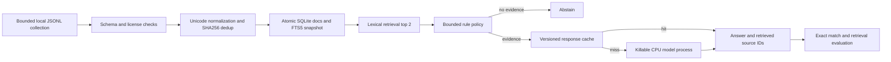

# [Mathematical Rigor]

## Assumptions and objective

The first experiment is single-host CPU inference on a fixed, synthetic English corpus.
Queries are serial closed-loop arrivals; this is not a saturation or open-loop queueing test.
The model is deterministic greedy FLAN-T5-small, FP32, 32 output tokens maximum,
512 input tokens maximum, two intra-op threads and one inter-op thread. Documents have
bounded size. The explicit policy retrieves at most two documents, optionally rewrites
one known phrase once, and answers or abstains. There is no learned planner or arbitrary tool use.

Minimize `C = CPU-seconds/request + lambda * retained-cache-bytes`, subject to experimental
targets `p95 <= 1500 ms`, exact-match quality `>= 0.90`, retrieval hit@2 `>= 0.95`,
error rate `= 0` on this finite workload, and sampled process-tree RSS `<= 2 GiB`.
These targets apply to warmed, serial queries. Startup is reported separately.
The weights' download and installation are outside query latency. CPU time and the
cache memory penalty are not directly measured, so observed latency is only a proxy for cost.
No dollar savings or production SLO compliance is asserted from this experiment.

For ready task i, admission requires both `sum(active_i) <= C_workers` and
`sum(active_i * reservation_i) <= B_reserved`. Dependencies must have succeeded first.
Reservations are cooperative estimates, not OS-enforced memory isolation. The persistent
model, retained graph outputs, interpreter, journal and FTS index add memory outside the
active-task reservation. Sample RSS separately; a container/job object hard limit is future work.
Graph metadata and retained outputs are O(V+E+output bytes), with V <= 1024 and a 2 MB corpus.
The stream queue holds Q waiting items, W active items, and at most one producer-held item.

Expected response-cache benefit is positive only when
`h * G > L + (1-h) * I + M`, where h is hit ratio, G is avoided generation/IPC cost,
L is lookup/key construction cost, I is insertion cost and M is amortized eviction/maintenance.
The cache-disabled vs empty-cache-enabled unique-query experiment estimates the overhead
regime; the repeated workload estimates amortized benefit. We do not assume all workloads repeat.
The 32-entry LRU and 1-hour TTL cap entries and age. Answers are bounded by generation length.

Hypothesis H1: repeat-query response caching reduces mean latency with identical answers.
H2: zero-reuse requests may be slower with caching. Test both; do not turn mean improvement
into a p99 improvement claim. Empirical nearest-rank p99 at n=60 is nearly the sample maximum,
so all first-run tail statistics are explicitly sample-limited.

# [CS Core & Backend Architecture]

`Executor` admits only ready tasks, creating at most C tasks at once. It scans a bounded
pending dictionary; this simple O(V^2) scheduler is acceptable for small DAGs, not a claim
of large-graph efficiency. Kahn validation rejects cycles and missing dependencies before
side effects. A failure cancels siblings, awaits cleanup, and marks pending nodes skipped.
Retries use capped exponential backoff and apply only up to each node's configured count.
Synchronous SQLite/JSON work is bounded but blocks the event loop; async timeouts cannot
preempt arbitrary Python/native blocking code or coroutines that swallow cancellation.
The real model instead communicates through asynchronous pipes and is terminated on
timeout/cancellation. On Windows the whole venv launcher process tree is terminated.
Process creation + loading is outside warm inference but included in startup measurement.

SQLite replaces documents and the FTS index in one transaction. Retrying ingestion yields
the same snapshot, and a failed transaction preserves the previous index. FTS5 is lexical,
not a vector embedding index. Query terms are extracted and quoted, and SQL values are bound.
No external database, network service, paid API, Ray, vLLM or DeepSpeed is necessary here.
The ingestion source is a checked-in local fixture; HTTP connectors are not implemented.

Pure-node replay uses a SQLite result key over namespace, node name/version and dependency
values plus run input. Callers must bump versions when code semantics change and mark
only deterministic side-effect-free nodes pure. Replay is not exactly-once external delivery;
crashes between an external effect and a journal commit can repeat that effect. The RAG
nodes do not use pure replay, so response-cache comparisons never silently reuse DAG results.
The journal records starts, attempts, durations, failure types, cancellations and cache hits.
Raw prompts and exception messages are excluded from journal events. Result replay may
persist supplied values, so this prototype is scoped to public synthetic data.

Response-cache keys include corpus digest, model revision/configuration/prompt version,
question and retrieved text. This cache reuses final answers. A retrieval cache would instead
reuse search results; a KV prefix cache would reuse attention state. Neither is implemented.
The measured encoder time and aggregate decoder generation time are separate. FLAN-T5 is
encoder-decoder: these are not a causal LLM's separately measured prefill, TTFT and inter-token
decode metrics. No KV-prefix-cache speedup is claimed.

The pipeline serializes DAGs per executor and one model serializes requests by a lock.
`bounded_stream` is an explicit upstream admission API; the CLI and benchmark use serial
submission. Creating unbounded external `query()` tasks would bypass upstream backpressure.
No admission fairness across multiple processes, distributed leases, replication, durable
queue, network retry protocol or crash-resume graph coordinator is implemented.
Local IPC serializes text; it is not zero-copy and does not imply free inter-node transport.

# [Low-Level Code & Open Source Reference]

Implementation order: Python control flow and stdlib SQLite, real CPU model integration,
then profile, then cache ablation. C++ and CUDA are deferred because measured time is in
existing model kernels and generation, not a demonstrated Python loop worth rewriting.

See `REFERENCES.md` for first-party source paths, versions, commits and licenses.
The first-party model card supports CPU use. The implementation uses the public
Transformers T5 encoder/generation APIs; it does not copy a scheduler from a distributed framework.
See `benchmarks/` for unedited raw observations and `RESEARCH.md` for interpretation.

## Failure and safety boundaries

Empty retrieval abstains; a nonempty irrelevant result can still lead to a wrong answer.
Returned source IDs are retrieved provenance, not sentence-level grounding verification.
License/schema validation and length limits are input hygiene, not alignment or a safety proof.
No prompt-injection resistance, personal-data detection, toxicity evaluation, adversarial
robustness or domain safety certification is claimed. The model has no shell/network tools.
Only pinned safetensors are loaded with `trust_remote_code=False`; downloads are explicit,
anonymous public requests and subsequent inference is offline. The recorded manifest detects
accidental local corruption; it is not a signed supply-chain attestation.
